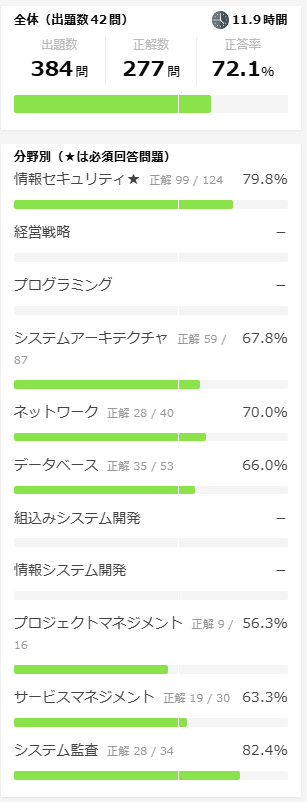

どうも、Bindです。

応用情報技術者試験を受験しました。
CBTになったのは聞いていましたが、午前午後（1日）が科目A・B（2日）になっているんですね。
基本情報技術者試験はCBT化前に受けましたが、丸一日の試験ってそれだけで大変なことだったので、半日×2回なんてもう楽勝でしょう！

## 1. 試験対策

試験は4択の科目A（旧午前）と選択＋記述の科目B（旧午後）で構成されています。
科目Aと科目Bの実施時期は分かれているので、それぞれの最短で申し込むと科目Aの受験から1か月程度開けて科目Bを受験することになります。

科目A対策はもうみんなこれだと思いますが、アプリで過去問を繰り返し繰り返し解いていました。
あとはそのうち来る科目B対策もかねて、その選択肢を選んだ理由も添えるようにしました。
相変わらずGeminiをはじめとした生成AIというのは便利なもので、模擬試験と採点をやってくれます。
科目Aは試験終了後即時採点なので結果はすぐに分かります。
750点で合格でした、一安心。

そこからは1か月程度あるのでがっつり準備！
とはいかず、ダラダラ過ごしてしまい、2週間程度経ってしまいました。
人間、余裕あるって思ってしまうとダメですね、嘘です、僕がダメなだけです。

科目Bは[応用情報技術者試験ドットコム](https://www.ap-siken.com/)をメインに進めました。
これも有名なサイトですね。
登録すればこんな感じで分かりやすくまとめてくれます。

僕は何となくどれを選択するかのあたりをつけてやっていたので部分的にしか解いていませんが、一通り解いてみてどれを選択するかの参考にも使えそうです。
（今見ると部分的に、どころか解いている数自体少ないですね……。）

あとはシラバスや過去3年分の過去問と回答解説をGemini Notebookに読ませて、間違えた問題の過去問とか自動採点で×になった理由の確認とかをしてました。

## 2. 科目B選択の方針

まず情報セキュリティは必須問題なので重点的にやっておきましょう。
僕の場合は割と実務でもよく関わる部分なのでそれほど苦も無く進められました。

あとは上の方の画像の通りですが、プログラミングなどの開発系はあらかじめ避けて、以下のように整理しています。

- **国語的な問題**：サービスマネジメント・システム監査などを中心に、長文に慣れる練習
- **技術的な問題**：ネットワーク・データベースなどは積極的に知識をインプット
- **科目Aの応用問題**：システムアーキテクチャ・プロジェクトマネジメントの知識をおさらい

結果的にはこの5問を選びました。

1. 情報セキュリティ
2. 経営戦略（！？）
3. システムアーキテクチャ
4. サービスマネジメント
5. システム監査

データベースを捨ててネットワークを取ろうと思ったんですが、若干意地悪な問題がいくつかあり、自信を持ち切れなかったのでぶっつけ本番の経営戦略を取りました。

ネットワークは試験後記憶をたどって答え合わせしてみましたが、なんやかんや結構あってたのでそのまま選択しておけばよかったです。
まあそんなこともありますね。

## 3. 本番当日の立ち回り

なんと愚かなことに会場間違えました。
試験開始は11時15分。
会場を間違えたことに気付いたのが11時。
正しい会場に走ること10分。
梅田にいくつかテストセンターがあって本当に良かった……。

問題自体はとりあえず全部さらっと見ましょう。
で、特に考えずに解けそうな問題から手を付けていきましょう。
1問に対して5分以上かかったら次に行くのが吉です、あとから戻ればいいので。

僕の場合は一通り解き終わったころで1時間程度経過していました。
そこから45分ほど見直して計105分、45分残して退室しました。
ということで、見直しにしっかり時間取るほうがいいです。

## 4. まとめ

合格発表は2027年1月中頃らしいです。
落ちてたら恥ずかしいので合否は特に更新しないと思います。
せっかく勉強したので細々した技術的な話はtechの方でまとめていきたい気もしますね。

次は情報処理安全確保支援士か、何かMicrosoft認定資格の勉強しようかな、と思ってます。
ちょうどセキュリティの話が熱いところなのでそこを進めようかな。

とにもかくにも、教訓は一つです。
試験会場はちゃんと確認しましょう。

それでは、ここまで読んでいただいてありがとうございました。